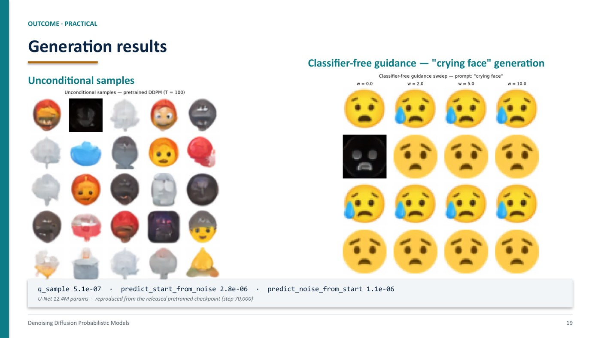
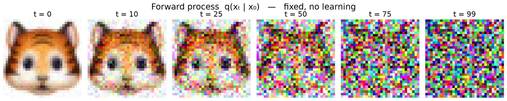
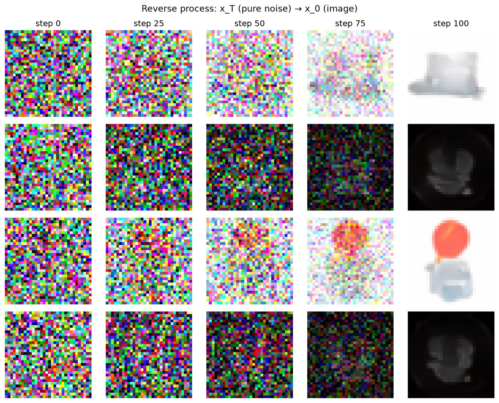
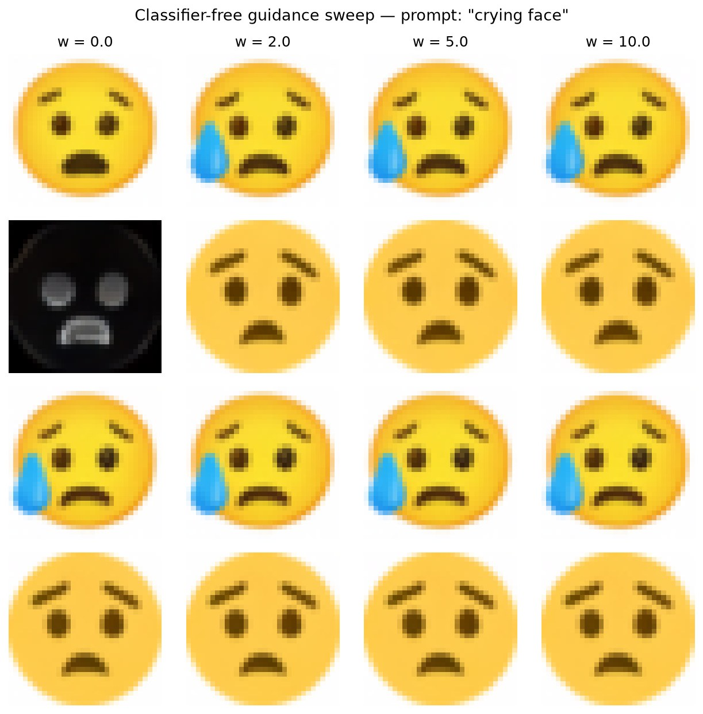
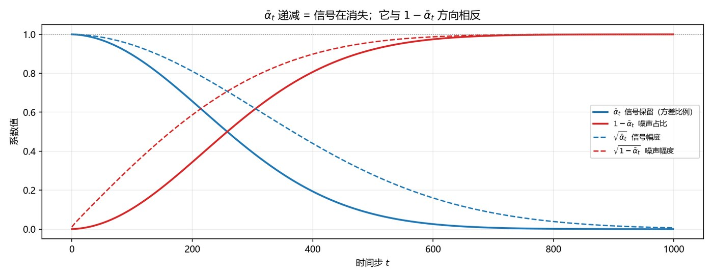
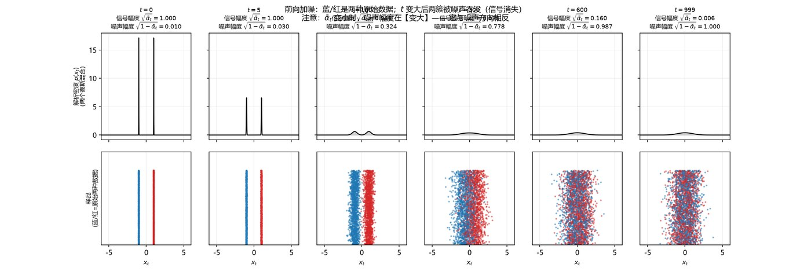
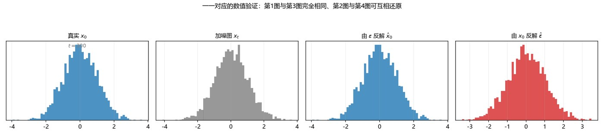
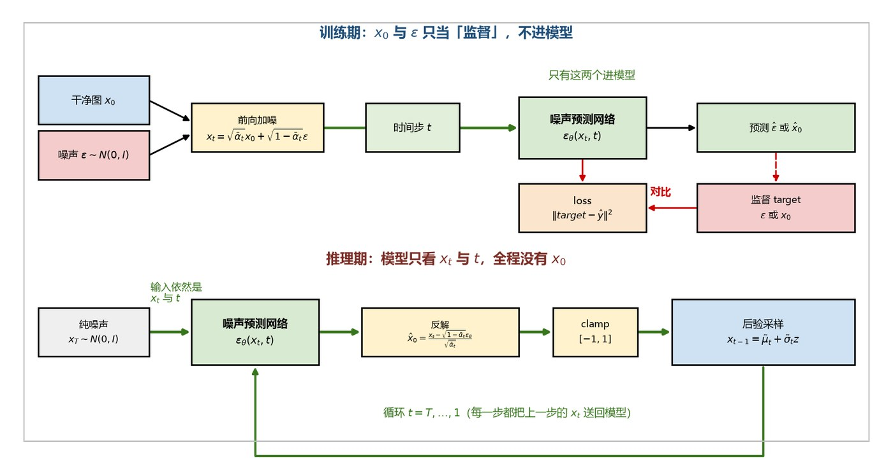

# Diffusion Models 学习与汇报资料集

从零理解 **Denoising Diffusion Probabilistic Models (DDPM)** 的完整学习记录：
直觉 → 数学推导 → PyTorch 实现 → 实验结果 → 学术汇报。

> **English**: A self-contained study pack for DDPM — intuition, full derivations
> (forward closed form → posterior → ELBO → noise-regression loss), a PyTorch
> implementation with verified numerical results, and a 22-slide academic
> report with LaTeX-typeset equations.

<p align="center">
  
</p>

---

## 目录导航

| 目录 | 内容 |
|---|---|
| [`docs/`](docs/) | **6 份学习文档** —— 学习指南、背诵卡、课件推导、作业实现、答辩 Q&A、知识索引 |
| [`slides/`](slides/) | **22 页学术汇报** PPTX + PDF（公式为真 LaTeX 排版） |
| [`references/`](references/) | **3 份参考课件**（第三方材料，含完整引用信息，见该目录） |
| [`figures/`](figures/) | 概念示意图、实验结果图、PPT 预览 |
| [`code/`](code/) | 汇报 PPT 的构建链、实验结果生成脚本、推导核验脚本 |

### 推荐阅读顺序

| 顺序 | 文档 | 用途 |
|---|---|---|
| 1 | [扩散模型学习指南](docs/扩散模型学习指南.md) | **主教材** —— 5 天路线，从直觉到前沿（含自测题） |
| 2 | [扩散模型背诵卡](docs/扩散模型背诵卡.md) | **背诵** —— 8 条必背公式 + 12 道默写题 |
| 3 | [课件小结（大工 & ZhangXin）](docs/扩散模型课件小结_大工与ZhangXin.md) | **推导** —— ELBO → KL → 噪声回归的完整链条 |
| 4 | [作业参考实现](docs/扩散模型作业参考实现.md) | **代码** —— CS231n Assignment 3 的 TODO 解法 |
| 5 | [答辩 Q&A 准备手册](docs/答辩Q&A准备手册.md) | **答辩** —— 39 个可能被问的问题 + 英文原句 |
| 6 | [知识整合](docs/DiffusionModel_知识整合.md) | **索引** —— 扩散内容在课程材料中的分布 |
| 7 | [摸底测验](docs/扩散模型测验.md) | **自测** —— 15 题分级诊断 + 批改记录 |

辅助材料：[VAE 与 UNet 速览](docs/VAE与UNet速览.pdf)（10 页对照表）

---

## 核心公式：一条式子派生全部

$$x_t=\sqrt{\bar\alpha_t}\,x_0+\sqrt{1-\bar\alpha_t}\,\varepsilon,
\qquad \varepsilon\sim\mathcal N(0,I)$$

| 要得到什么 | 怎么变 |
|---|---|
| 反解 $x_0$ | 移项 |
| 反解 $\varepsilon$ | 移项 |
| 前向闭式分布 | 写成高斯形式 $\mathcal N(\sqrt{\bar\alpha_t}\,x_0,(1-\bar\alpha_t)I)$ |
| 训练目标 | 让网络预测式中的 $\varepsilon$ |
| 采样 | 每步反解 $\hat x_0$，再代进后验分布 |

### 从最大似然到训练损失

```
①  max_θ  log p_θ(x₀)                 ← 目标：最大似然（不可解，需积分掉 x_{1:T}）
              ↓ 沿马尔可夫链拆解
②  -ELBO = L_T(常数) + Σ L_{t-1} + L₀
              ↓ 每步是两个高斯之比的 KL
③  L_{t-1} = D_KL( q(x_{t-1}|x_t,x₀) ‖ p_θ(x_{t-1}|x_t) )
              ↓ 方差固定 → 协方差项为常数，只剩均值差
④  = (1/2σ̃ₜ²)‖ μ̃ₜ − μ_θ ‖²
              ↓ 用 ε 重参数化均值
⑤  = (SNRₜ/2σ̃ₜ²)·‖ ε − ε_θ(xₜ,t) ‖²   ← 完整 ELBO（L_vlb）
              ↓ 丢掉 SNR 权重
⑥  L_simple = E[ ‖ ε − ε_θ(xₜ,t) ‖² ]    ← 实际训练用的目标
```

> ⚠️ 第 ⑤→⑥ 步**丢掉了 SNR 权重**，所以 `L_simple` **不再是似然下界** ——
> 但 Ho et al. 发现这样训练出来的样本质量更好。这是「理论正确 ≠ 实践最优」的经典案例。

---

## 实验结果

<div align="center">

| 前向加噪过程 | 反向采样过程 |
|---|---|
|  |  |

**Classifier-Free Guidance 消融**（prompt: `crying face`，w = 0 / 2 / 5 / 10）



</div>

> 模型：12.4M 参数的 U-Net，T = 100 步，32×32 emoji 数据集。
> 权重来自课程发布的预训练 checkpoint（step 70,000）。

### 数值验证

| 测试项 | 实测相对误差 | 要求 |
|---|---|---|
| `q_sample` | **5.104e-07** | ~0 |
| `predict_start_from_noise` | **2.798e-06** | < 1e-5 |
| `predict_noise_from_start` | **1.060e-06** | < 1e-5 |
| U-Net 参数量（`dim=2, mult=(1,2,4)`） | **6,499** | == 6,499 |

详见 [`figures/results/verify.txt`](figures/results/verify.txt)。

---

## PowerPoint 的公式是怎么排的

汇报 PPT 里的 22 个公式**不是截图拼接，而是用真 LaTeX 编译成矢量级 PNG**：

```
latex_spec.py  (LaTeX 源码)
      ↓
pdflatex  →  PDF  →  Ghostscript (bbox + 400dpi)  →  透明 PNG
      ↓
render_eqs_latex.py  (两遍渲染 + 字号自适应)
      ↓
build_deck.py  →  PPTX
```

**关键设计**：
- **两遍渲染**：先量出每个公式的自然宽度，再为过宽的公式单独降字号 → 全 deck 物理字号一致
- **真 Computer Modern**：变量斜体、真 TeX 间距（而非 matplotlib mathtext 的正体近似）
- 公式图见 [`code/deck-build/`](code/deck-build/)，重跑方式：

```powershell
python code/deck-build/render_eqs_latex.py   # 需要 TeX Live + Ghostscript
python code/deck-build/build_deck.py
```

---

## 概念示意图

这些图是[第 1 天的概念重建实验](code/verification/day1_concept_lab.py)产出的，
用来纠正三处常见误解：$\bar\alpha_t$ 的方向、$x_0$ 与 $\varepsilon$ 的一一对应、
训练期 / 推理期的区分。

<div align="center">

| $\bar\alpha_t$ 与 $1-\bar\alpha_t$ 方向相反 | 前向加噪：信号被噪声吞没 |
|---|---|
|  |  |

| $x_0 \leftrightarrow \varepsilon$ 一一对应 | 训练期 vs 推理期 |
|---|---|
|  |  |

</div>

---

## 仓库结构

```
.
├── docs/                     # 6 份学习文档 + VAE/UNet 速览
├── slides/                   # 22 页汇报 PPTX + PDF
├── references/               # 第三方参考课件（版权归原作者）
├── figures/
│   ├── concepts/             # 概念重建实验配图
│   ├── results/              # 实验结果图 + 数值验证
│   └── slides/               # PPT 关键页预览
└── code/
    ├── deck-build/           # PPT 构建链（LaTeX → PNG → PPTX）
    ├── demo/                 # 实验结果生成与核验
    └── verification/         # 推导的数值核验脚本
```

---

## 关于本仓库的边界

**包含**：我自己整理的学习文档、推导、PPT 构建脚本、实验脚本与结果。

**不包含**（有意排除）：

| 排除内容 | 原因 |
|---|---|
| CS231n Assignment 3 的代码骨架 | 课程作业版权与学术诚信 |
| 数据集与预训练权重（约 170 MB） | 体积过大，由课程脚本自动下载 |
| PPT 的历史备份文件 | 与本仓库目的无关 |

> ⚠️ [`references/`](references/) 中的三份课件均为**第三方材料**，版权归原作者及所属机构所有，
> 此处仅作个人学习参考，并已逐份标注作者、日期与来源。若权利人要求移除，
> 请提 issue，我会立即删除。详见 [`references/README.md`](references/README.md)。

> 📌 `code/demo/` 下的脚本依赖课程提供的 `cs231n/` 代码骨架与预训练权重，
> 需自行从作业包获取后才能运行。

---

## 引用与致谢

**核心论文**

> Ho, J., Jain, A., & Abbeel, P. (2020). *Denoising Diffusion Probabilistic Models*.
> Advances in Neural Information Processing Systems (NeurIPS) 33.
> [arXiv:2006.11239](https://arxiv.org/abs/2006.11239)

**课程与课件**（原件见 [`references/`](references/)，版权归原作者）

| 材料 | 作者 | 来源 |
|---|---|---|
| CS231n Lecture 14: Generative Models (Part 2) — Diffusion | Li Fei-Fei, Ehsan Adeli, Zane Durante, Justin Johnson, Serena Xiang (Stanford) | [cs231n.stanford.edu](https://cs231n.stanford.edu/) |
| 【大白话01】一文理清 Diffusion Model（原理图解+公式推导） | 张鑫（bilibili UP 主「吃花椒的麦」），2024-07-01 | [BV1xih7ecEMb](https://www.bilibili.com/video/BV1xih7ecEMb) |
| DDPM 原理（课程讲义） | 大连理工大学 | 原始渠道待补充 |

**其他**

- 生成模型分类图引自 Goodfellow, I. (2017). *Tutorial on Generative Adversarial Networks*
- U-Net 架构引自 Ronneberger, O., Fischer, P., & Brox, T. (2015). *U-Net: Convolutional Networks for Biomedical Image Segmentation*. [arXiv:1505.04597](https://arxiv.org/abs/1505.04597)
- Classifier-free guidance 引自 Ho, J., & Salimans, T. (2022). *Classifier-Free Diffusion Guidance*. [arXiv:2207.12598](https://arxiv.org/abs/2207.12598)

---

## License

代码以 [MIT](LICENSE) 授权；文档与图片以 [CC BY 4.0](https://creativecommons.org/licenses/by/4.0/) 授权。
第三方材料的版权归各自作者所有。
